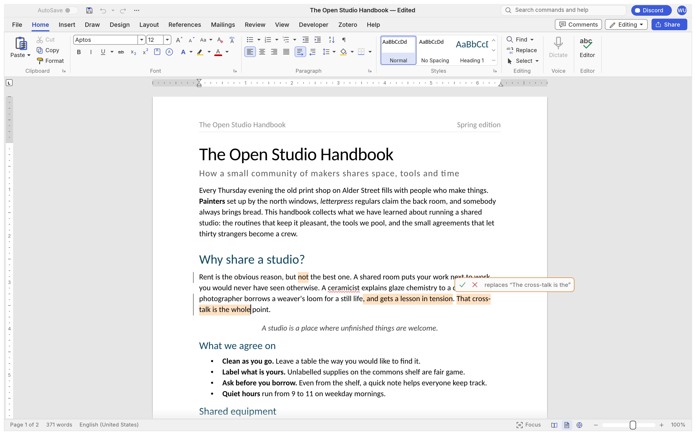
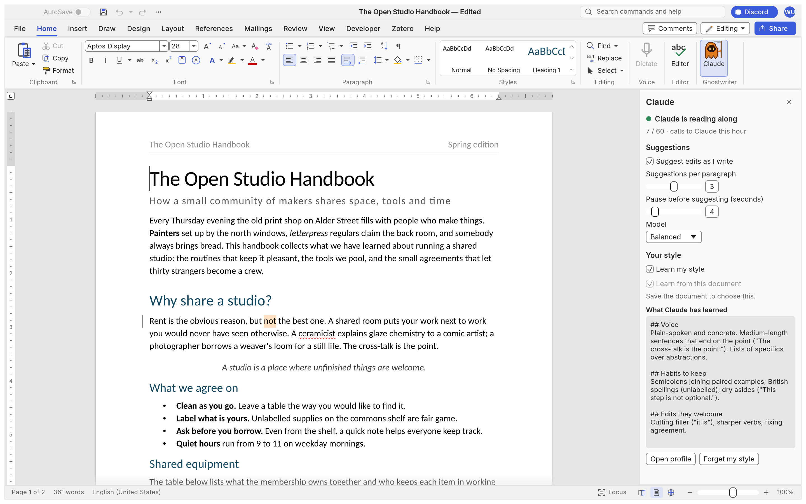

<h1 align="center">Ghostwriter</h1>

<p align="center">
  <b>A word processor where Claude suggests edits in the page as you write.</b>
</p>

<p align="center">
  You keep typing. When you pause, Claude reads the paragraph you're on and puts a few edits
  right where they would go, in orange. Hover one and click <b>✓</b> or <b>✗</b>. You stay the
  author: nothing changes unless you accept it.
</p>

<p align="center">
  
  
  
</p>

<p align="center">
  
</p>

<p align="center">
  <a href="#how-it-works">How it works</a> ·
  <a href="#install">Install</a> ·
  <a href="#write-with-the-companion">The companion</a> ·
  <a href="#ask-claude-directly">Ask Claude directly</a> ·
  <a href="#roadmap">Roadmap</a> ·
  <a href="#built-on-wordcraft">Built on WordCraft</a> ·
  <a href="#license-and-credits">License</a>
</p>

## How it works

- **Suggestions, not rewrites.** Claude never edits your text directly. Each suggestion shows in
  the page as the paragraph would read once accepted, with the words it would replace hidden. Hover
  it, or put the caret on it, to see what it replaces.
- **Live, but out of your way.** Suggestions arrive a few seconds after you stop typing, only for
  the paragraphs around your caret that changed. They never move your caret and never land in the
  words you're typing.
- **Picks up your style by itself.** You don't describe your voice. Claude reads what you write
  and builds a style profile from it once there's a page or so, then keeps refining it as you
  write more and as you accept and reject its suggestions. Kinds of edits you reject stop coming
  back. Claude's job is to sharpen your prose, not to write it: small edits in your words, never
  new sentences or ideas of its own.
- **A brief if you want one.** Optionally, point it at a few lines on the piece (thesis,
  audience) and Claude holds its suggestions to them too.
- **Your Claude subscription, no API key.** Claude runs through Claude Code (`claude -p`) on your
  own login.
- **Plain tracked changes underneath.** A suggestion is a tracked change by
  *Claude (suggestion)*: Ctrl+Z undoes an accept, saving keeps the pending ones, and Word opens
  them as ordinary tracked changes.

## Install

Windows 10 or 11, x64 or ARM64.

1. Install [Claude Code](https://claude.com/claude-code) and sign in once (`claude`, then
   `/login`). Check that `claude -p "say hi"` answers in a terminal.
2. Download `ghostwriter-<version>-windows-x64.msi` (or `-arm64`) from the
   [latest release](https://github.com/HaydenHarms/ghostwriter/releases/latest) and run it. The
   build isn't code-signed, so SmartScreen asks first: **More info → Run anyway**.
3. Open **Ghostwriter** from the Start menu, or by opening a .docx with it.

The portable zip has the same programs without an installer, plus the Claude Code skill.
`SHA256SUMS.txt` on each release lists a checksum for every file.

## Write with Claude

Open the **Claude** panel (Home › **Claude**, or type "Claude" in the search box) and click
**Start Claude**. That's it: Claude reads along as you write and stops when you close the window.

<p align="center">
  
</p>

The panel is where you steer it, and changes apply at once:

- **Suggestions** on or off, how many per paragraph, and how long you pause before Claude looks.
- **Model**: Fast (lighter on your plan's limits), Balanced, or Thorough.
- **Learn my style** on or off, and **Learn from this document** off for someone else's writing.
- **Ask Claude**, on request: **Suggest a transition** into the paragraph you're in, **Suggest a
  missing step** where its reasoning jumps, or **Review structure** for notes on the whole piece's
  order and flow (click a note to jump to its paragraph). What Claude adds still arrives as
  suggestions.
- **What Claude has learned**: your style profile, with **Open profile** and **Forget my style**.
- Whether Claude is running, and how many calls it has made this hour.

| | |
|---|---|
| Accept | ✓ on the card, or **Alt+Shift+Enter** with the caret in the suggestion |
| Reject | ✗ on the card, or **Alt+Shift+Backspace** |
| Undo | Ctrl+Z |
| All at once | Review › Accept All / Reject All |

You can also run `ghostwriter-companion` in a terminal yourself, for example with
`--brief my-essay.brief.md` to hold suggestions to a few lines on the piece's thesis and audience.
The full guide, with every option, is in [docs/companion.md](docs/companion.md).

## Ask Claude directly

You can also ask Claude Code for suggestions when you want them: *"tighten paragraph 3"*, *"check
my citations against the brief"*. They land in the page the same way.

```powershell
claude mcp add ghostwriter -- ghostwriter-cli mcp --connect 127.0.0.1:7981
```

The server tells Claude how to suggest when it connects. The [skill](skills/ghostwriter/SKILL.md)
adds worked examples: copy `skills/ghostwriter/` to `%USERPROFILE%\.claude\skills\ghostwriter\`.
Claude Desktop and other MCP clients use the same command. Any client can run the `suggest.*`
commands (`context`, `add`, `list`, `accept`, `reject`, `withdraw`). They're described in
[docs/companion.md](docs/companion.md#the-commands).

## Roadmap

Ghostwriter **1.2** runs on Windows, with the Claude panel, style learning and Ask Claude.
After that, roughly in order:

1. **Own settings**, so Ghostwriter and WordCraft can be open side by side.
2. **macOS and Linux** packages (the code already builds there; only packaging is Windows-only).

Details and progress: [ROADMAP.md](ROADMAP.md).

## Built on WordCraft

The word processor itself is [WordCraft](https://github.com/storytold/wordcraft), an open-source,
Rust-native word processor by the ArtCraft team and the WordCraft contributors. It provides the
editor, layout, styles, tables, track changes, .docx/.odt/.rtf/PDF files, the MCP server and the
command system Ghostwriter's suggestions run on. Ghostwriter follows WordCraft's `main` branch and
keeps its own changes small and marked, so upstream improvements keep flowing in.
[docs/companion.md](docs/companion.md#how-it-fits-in-wordcraft) lists every file it touches.

Ghostwriter's goal is live Claude suggestions, not copying Word. Questions about WordCraft's
Word-compatible features, and the parity documents in [`docs/`](docs/) that track them, belong to
upstream.

### Build from source

```powershell
git clone https://github.com/HaydenHarms/ghostwriter
cd ghostwriter
cargo build --release -p wordcraft -p wordcraft-cli -p wordcraft-companion
.\target\release\wordcraft.exe --control 7981 my-essay.docx
.\target\release\wordcraft-companion.exe
```

From source the programs keep WordCraft's file names. The release packaging renames them to
`ghostwriter*.exe`. `cargo xtask ci` runs formatting, clippy, the tests, the asset, layering and
wasm checks. Agent instructions: [AGENTS.md](AGENTS.md).

## License and credits

Ghostwriter is dual-licensed under [MIT](LICENSE-MIT) or [Apache-2.0](LICENSE-APACHE), at your
option, like WordCraft. Copyright (c) 2026 ArtCraft Team and the WordCraft contributors; required
notices are in [NOTICE](NOTICE). Bundled fonts, icons, images and other assets keep their own open
licenses, listed in [ATTRIBUTION.md](ATTRIBUTION.md).

Ghostwriter is an independent fork. It isn't made or endorsed by the ArtCraft team, and the
ArtCraft name and logos are theirs: see [`docs/brand/LICENSE-brand.txt`](docs/brand/LICENSE-brand.txt).

<sub>Claude and Claude Code are trademarks of Anthropic, PBC. Microsoft Word is a trademark of the Microsoft group of companies. Ghostwriter is not affiliated with, sponsored by or endorsed by Anthropic, Microsoft or the ArtCraft team.</sub>
